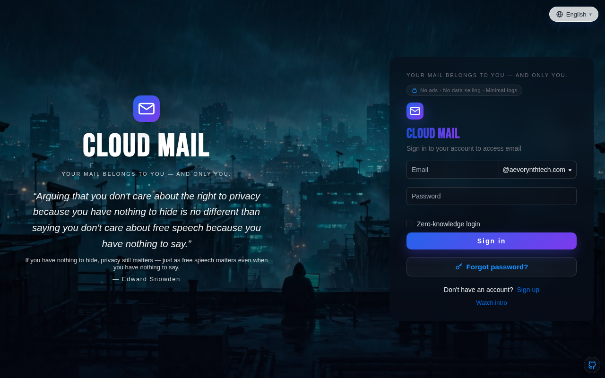
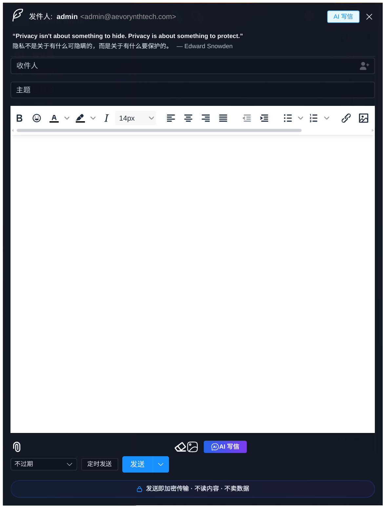
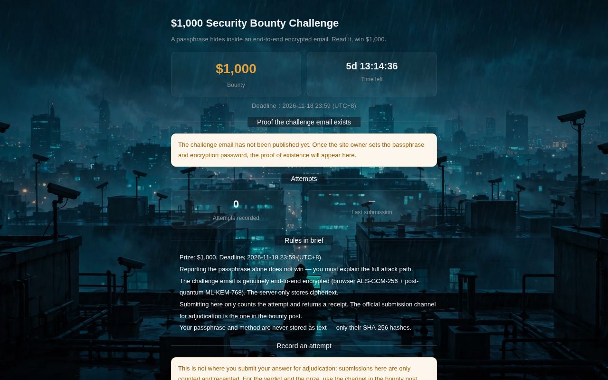

    <h1 align="center">Mail Ultimate</h1>
    
<strong>Snowden-grade encrypted email — your mail belongs to you, and only you.</strong>

    

        
        
    

    

        <a href="https://aevorynthtech.com">Business Mail</a> · <a href="https://mail.flame.edu.kg">Student Mail</a> ·
        <a href="README.md">简体中文</a> | English
    

## 🚀 Sign up

| Site | Address |
|---|---|
| Business Mail | https://aevorynthtech.com |
| Student Mail | https://mail.flame.edu.kg |

Invite code: **FREESnowden**

Student Mail is a free `.edu` mailbox, valid until **2083**. No student ID, no transcript, no tuition.

## Screenshots

**Login page — Snowden theme, full-screen wallpaper + rotating quotes**

**Compose window — AI writing, encrypted on send**

**Bounty challenge page — $1,000 security bounty, end-to-end encryption proof**

## Built-in wallpapers (sample)

| City of Surveillance | Moscow Rainy Night | 39 Days at the Airport |
|---|---|---|
|  |  |  |

57 built-in wallpapers in total: Snowden cinematic vistas, Victoria's Secret runway photos, and more.

## ✨ What makes it different

- **🔒 End-to-end encryption (optional)**: mail is encrypted in the browser before upload; the server only stores ciphertext. With E2EE on, not even the admin can read in-site mail.
- **🛡️ Security Center**: security score, TOTP two-factor, Passkey, login history, device management, audit logs — your account security on one page.
- **🕵️ 17 Snowden privacy features**: zero-knowledge login, minimal logs, no data selling, login alerts, IP allowlist, privacy dashboard, and more.
- **🤖 AI features**: AI translation, AI summary, AI writing, verification-code recognition — 50 uses per user per day.
- **🎓 Free .edu student mailbox**: valid until 2083.
- **🌍 14 languages**: fully translated interface.
- **🎨 57 built-in wallpapers**: Snowden cinematic vistas, Victoria's Secret runway photos, and more; custom login background and transparency.
- **📲 Telegram binding & mail forwarding**: new mail pushed to Telegram or another mailbox in real time.
- **📧 Full mail features**: bulk send, attachments (R2 storage), mail rules, contacts, starred, spam.
- **🛡️ Admin features**: user & mail management, RBAC permission control, open API, data visualization.
- **💰 Low cost**: runs on Cloudflare Workers, from $5/month.

## 🆕 What's new vs. the original

- 🆕 **Snowden theme**: full-screen login wallpaper, rotating quotes, privacy dashboard — the original is a plain interface.
- 🆕 **Security Center**: score, TOTP, Passkey, login history, device management — not in the original.
- 🆕 **End-to-end encryption (E2EE)**: browser-side encryption, ciphertext-only storage — not in the original.
- 🆕 **AI translation / AI summary / AI writing**: the original only had verification-code recognition.
- 🆕 **Free .edu student mailbox**, valid until 2083 — not in the original.
- 🆕 **14 languages, 57 wallpapers, Telegram binding, open-source code section.**
- 🆕 **Invite-code registration + Turnstile + rate-limit defenses** against bulk sign-up abuse.
- 🆕 **Privacy slogans built into the product**: login page, compose window, sidebar — Snowden everywhere.

## Tech stack

- **Platform**: [Cloudflare Workers](https://developers.cloudflare.com/workers/)
- **Web framework**: [Hono](https://hono.dev/)
- **ORM**: [Drizzle](https://orm.drizzle.team/)
- **Frontend**: [Vue3](https://vuejs.org/)
- **UI framework**: [Element Plus](https://element-plus.org/)
- **Sending**: [Cloudflare Email](https://developers.cloudflare.com/email-service/) / [Resend](https://resend.com/)
- **Cache**: [Cloudflare KV](https://developers.cloudflare.com/kv/)
- **Database**: [Cloudflare D1](https://developers.cloudflare.com/d1/)
- **Storage**: [Cloudflare R2](https://developers.cloudflare.com/r2/)

## License

MIT — see [LICENSE](LICENSE).

## Community

[Telegram group](https://t.me/nicofreevery)

---

A fork of cloud-mail under the MIT license, rebuilt around privacy.
