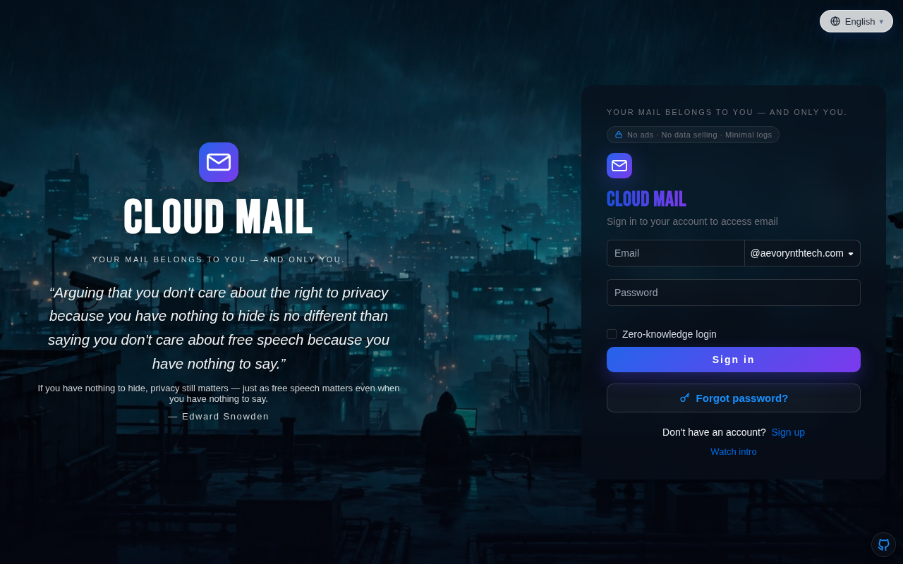
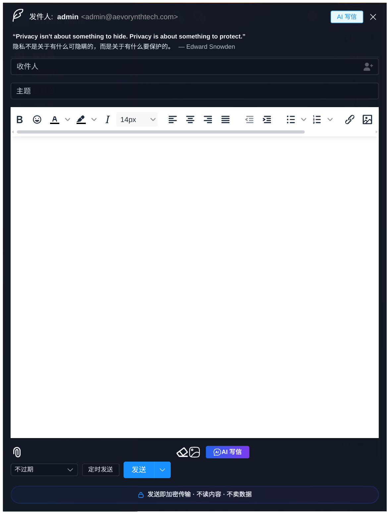
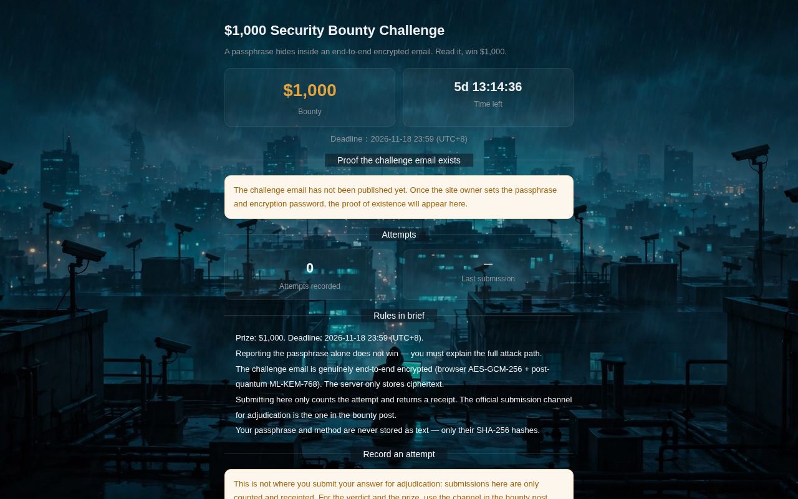

<p align="center">
    <h1 align="center">Mail Ultimate</h1>
    <p align="center"><strong>斯诺登级加密邮箱 —— 你的邮件只属于你</strong></p>
    <p align="center">
        <a href="https://www.cloudflare.com/" target="_blank">
            
        </a>
        <a href="https://github.com/kimi712/mail-ultimate/tree/main?tab=MIT-1-ov-file" target="_blank">
            
        </a>
    </p>
    <p align="center">
        <a href="https://aevorynthtech.com">企业邮箱</a> · <a href="https://mail.flame.edu.kg">学生邮箱</a> ·
        <a href="README-en.md">English</a> | 简体中文
    </p>
</p>

## 🚀 立即注册

| 站点 | 地址 |
|---|---|
| 企业邮箱 | https://aevorynthtech.com |
| 学生邮箱 | https://mail.flame.edu.kg |

注册邀请码：**FREESnowden**

学生邮箱是免费的 `.edu` 邮箱，用到 **2083 年**，不要学生证、不要成绩单、不要学费。

## 界面预览

**登录页 —— 斯诺登主题，全屏壁纸 + 轮换名言**



**写信窗口 —— AI 写信，发送即加密传输**



**悬赏挑战页 —— $1,000 安全赏金，端到端加密验证**



## 内置壁纸（部分）

| 监控之城 | 莫斯科雨夜 | 机场 39 天 |
|---|---|---|
|  |  |  |

共 57 张内置壁纸：斯诺登主题电影感远景、维密大秀实拍等。

## ✨ 我们的特色

- **🔒 端到端加密（可选）**：邮件在浏览器端加密后再上传，服务器只存密文；开启 E2EE 的站内邮件，连管理员也读不了
- **🛡️ 安全中心**：安全评分、TOTP 二次验证、Passkey（通行密钥）、登录记录、设备管理、审计记录，一页看清账号安全状况
- **🕵️ 17 项斯诺登隐私功能**：零知识登录、最小日志、不卖数据、登录提醒、IP 白名单、隐私仪表盘等
- **🤖 AI 功能**：AI 翻译、AI 摘要、AI 写信、验证码识别，每用户每天 50 次
- **🎓 免费 .edu 学生邮箱**：用到 2083 年，注册就送
- **🌍 14 种语言**：界面全量翻译
- **🎨 57 张内置壁纸**：斯诺登主题电影感远景、维密大秀实拍等，可自定义登录背景与透明度
- **📲 TG 绑定与邮件转发**：新邮件实时推送到 Telegram 或其他邮箱
- **📧 邮件全功能**：群发、附件收发（R2 存储）、邮件规则、联系人、星标、垃圾邮件
- **🛡️ 管理员功能**：用户与邮件管理、RBAC 权限控制、开放 API、数据可视化
- **💰 低成本**：部署到 Cloudflare Workers，成本低至 $5/月

## 🆕 与原版相比，更新了什么

一眼看懂这个项目多了什么：

- 🆕 **斯诺登主题**：登录页全屏壁纸、轮换名言、隐私仪表盘，原版是普通界面
- 🆕 **安全中心**：安全评分、TOTP、Passkey、登录记录、设备管理，原版没有
- 🆕 **端到端加密 E2EE**：浏览器端加密、服务器只存密文，原版没有
- 🆕 **AI 翻译 / AI 摘要 / AI 写信**：原版只有验证码识别
- 🆕 **免费 .edu 学生邮箱**：用到 2083 年，原版没有
- 🆕 **14 种语言、57 张壁纸、TG 绑定、开源代码分区**
- 🆕 **邀请码注册 + Turnstile 人机验证 + 限流防线**：防批量注册薅接口
- 🆕 **隐私口号写进产品里**：登录页、写信窗口、侧栏处处都是斯诺登

## 技术栈

- **平台**：[Cloudflare Workers](https://developers.cloudflare.com/workers/)
- **Web 框架**：[Hono](https://hono.dev/)
- **ORM**：[Drizzle](https://orm.drizzle.team/)
- **前端框架**：[Vue3](https://vuejs.org/)
- **UI 框架**：[Element Plus](https://element-plus.org/)
- **邮件发送**：[Cloudflare Email](https://developers.cloudflare.com/email-service/) / [Resend](https://resend.com/)
- **缓存**：[Cloudflare KV](https://developers.cloudflare.com/kv/)
- **数据库**：[Cloudflare D1](https://developers.cloudflare.com/d1/)
- **文件存储**：[Cloudflare R2](https://developers.cloudflare.com/r2/)

## 目录结构

```
mail-ultimate
├── mail-worker                    # worker 后端项目
│   ├── src
│   │   ├── api                    # api 接口层
│   │   ├── const                  # 项目常量
│   │   ├── dao                    # 数据访问层
│   │   ├── email                  # 邮件处理接收
│   │   ├── entity                 # 数据库实体
│   │   ├── error                  # 自定义异常
│   │   ├── hono                   # web 框架配置、拦截器、全局异常等
│   │   ├── i18n                   # 语言国际化
│   │   ├── init                   # 数据库缓存初始化
│   │   ├── model                  # 响应体数据封装
│   │   ├── security               # 身份权限认证
│   │   ├── service                # 业务服务层
│   │   ├── template               # 消息模板
│   │   ├── utils                  # 工具类
│   │   └── index.js               # 入口文件
│   ├── package.json               # 项目依赖
│   └── wrangler.toml              # 项目配置
│
├── mail-vue                       # vue 前端项目
│   ├── src
│   │   ├── axios                  # axios 配置
│   │   ├── components             # 自定义组件
│   │   ├── echarts                # echarts 组件导入
│   │   ├── i18n                   # 语言国际化
│   │   ├── init                   # 入站初始化
│   │   ├── layout                 # 主体布局组件
│   │   ├── perm                   # 权限认证
│   │   ├── request                # api 接口
│   │   ├── router                 # 路由配置
│   │   ├── store                  # 全局状态管理
│   │   ├── utils                  # 工具类
│   │   ├── views                  # 页面组件
│   │   ├── app.vue                # 入口组件
│   │   ├── main.js                # 入口 js
│   │   └── style.css              # 全局 css
│   ├── package.json               # 项目依赖
└── └── env.release                # 项目配置
```

## 许可证

本项目采用 [MIT](LICENSE) 许可证。

## 交流

[Telegram 群组](https://t.me/nicofreevery)

---

本项目基于 MIT 协议的 cloud-mail 二次开发。
